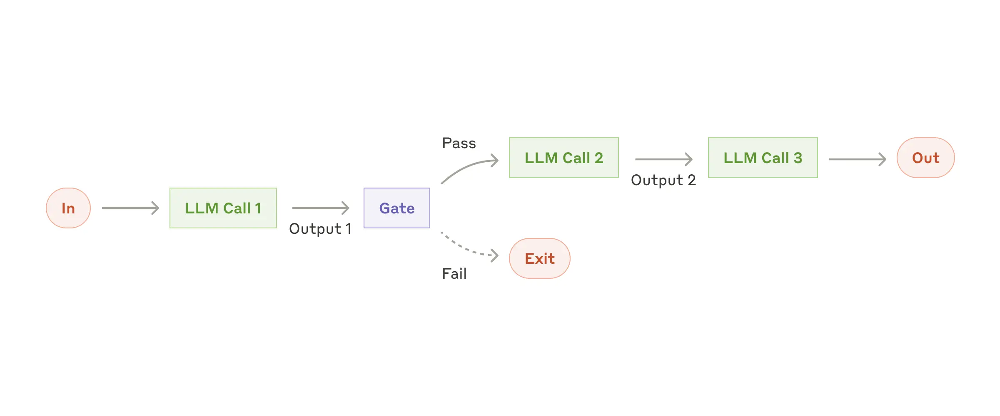
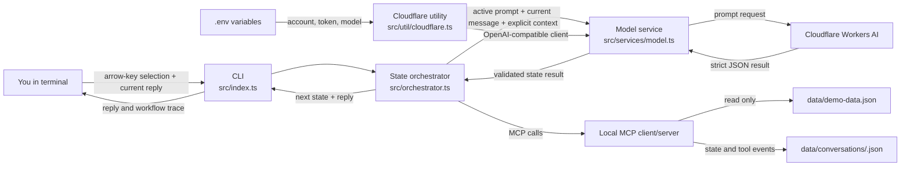
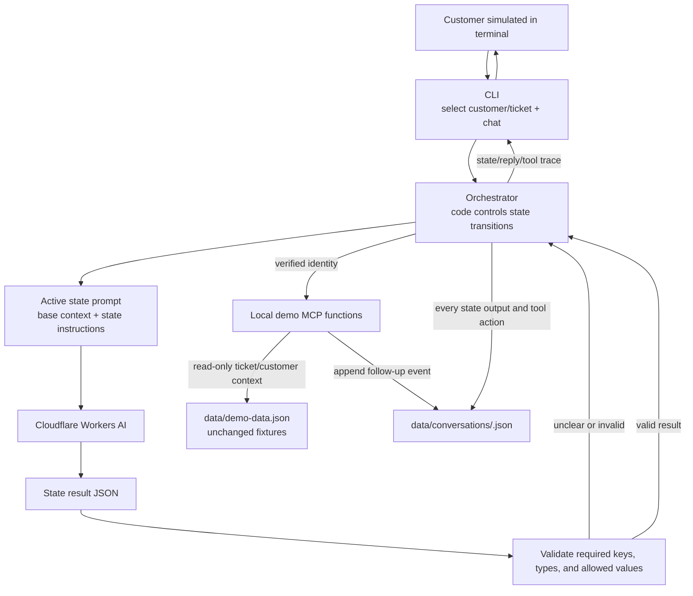
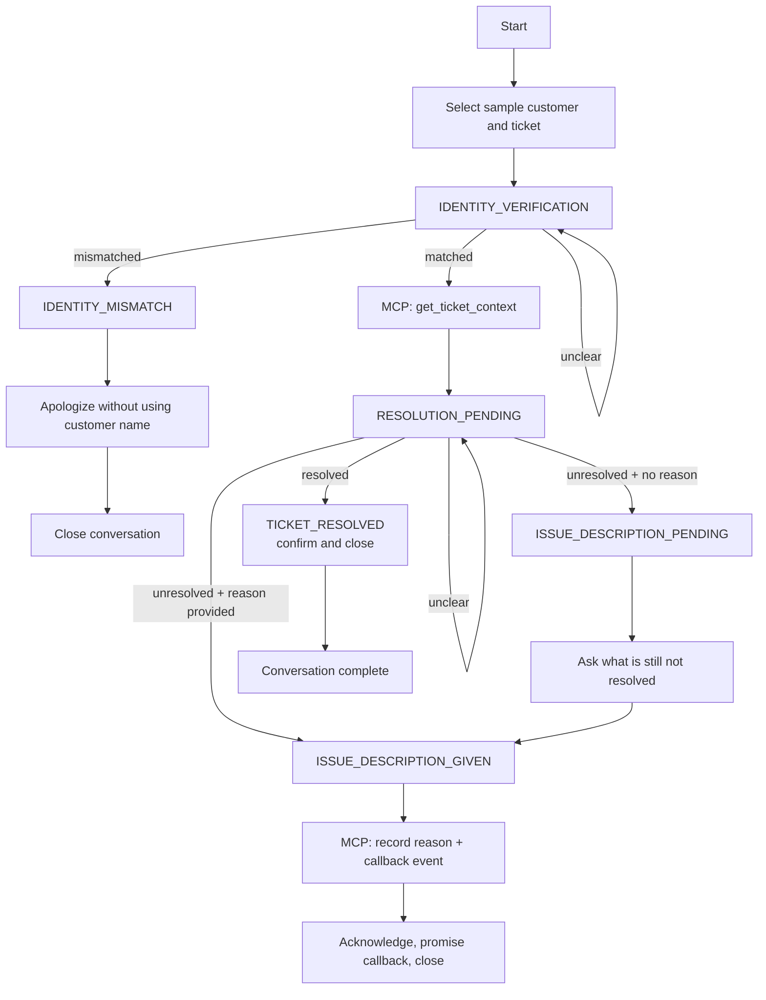

# Call Audit Prompt Chaining Demo

A CLI demo of a stateless, state-based support chatbot for **NComputing India**. It follows up after a technical support ticket is closed, verifies the customer, asks whether the issue is resolved, and records an unresolved reason and callback request.

The workflow uses **GLM-5.3-Flash** through Cloudflare Workers AI. The configured model identifier is `@cf/zai-org/glm-5.3-flash`; change `CLOUDFLARE_AI_MODEL` to use another Workers AI model available to your account.

> **Status:** Phases 1–3 are implemented. The CLI selects synthetic customers and tickets, runs a stateless prompt chain, validates structured model results, calls local MCP tools, and writes per-conversation event logs.

## Table of contents

- [What is prompt chaining?](#what-is-prompt-chaining)
- [What this demo is teaching](#what-this-demo-is-teaching)
- [Functional features](#functional-features)
- [Prompt guardrails and classification](#prompt-guardrails-and-classification)
- [How the system works](#how-the-system-works)
- [System components](#system-components)
- [Conversation state flow](#conversation-state-flow)
- [Run locally](#run-locally)
- [Run with DDEV](#run-with-ddev)
- [Environment variables](#environment-variables)
- [Project structure](#project-structure)
- [State JSON contracts](#state-json-contracts)
- [References](#references)
- [Current limitations](#current-limitations)
- [Phase 3 E2E smoke test](#phase-3-e2e-smoke-test-human-run)

## What is prompt chaining?

Prompt chaining breaks a larger task into a sequence of smaller model steps. Each step has a focused prompt, receives the context it needs, and returns a result that the application can validate and pass to the next step.

For this project, the intended chain is a fixed customer-support workflow: verify identity, check ticket resolution, and, when needed, collect the unresolved reason. The application code acts as the orchestrator: it chooses which state prompt runs next and validates the model's JSON outcome before changing state. The model writes the response for the current step; code controls the workflow.

This is a **workflow using an LLM**, rather than an autonomous agent that chooses its own sequence of actions. Keeping the transitions in code makes the conversation easier to inspect and reason about. The model classifies the current turn with the active state prompt; the application validates its JSON and chooses the next state.

### Prompt chaining with a gate

This diagram illustrates the general pattern: one model call produces structured output, an application gate checks that output, and only a passing result continues to the next step. A failed result can stop the flow.



In this demo, the gate is the strict JSON schema validation plus the code-based state transition rules. Each customer turn goes to the LLM with the active state prompt; there is no separate LLM call used only for routing.

## What this demo is teaching

- How focused prompts can each handle one part of a larger conversation.
- How an orchestrator can keep the application in a state until it receives a valid state result.
- How to ask a model for structured JSON and validate it before using the result.
- How a tool/MCP boundary can fetch ticket context or record a follow-up.
- How local event logs can make the state transitions and tool actions inspectable.
- How to separate model-written language from deterministic application decisions.

## Functional features

### Implemented in Phase 1

- Start a chatbot in the terminal and send messages to Cloudflare Workers AI.
- Treat every message as an independent request; send only the current user message to the model and keep no conversation history.
- Configure the Cloudflare account, API token, and model through environment variables.
- Report all missing required configuration variables before opening the chat.
- Display model/API errors and exit the current chat; enter `/exit` or press Ctrl+C to end the session.

### Implemented in Phase 2

- Add a shared base prompt with agent personality, NComputing India context, and the reason for contacting the customer.
- Add one focused prompt for each of the six states.
- Validate model output as strict JSON, reject extra/missing fields, enforce state-specific values, and check that the result belongs to the active state.
- Send only the current user message, the active prompts, and explicit context with a state request; never include previous chat turns.

### Implemented in Phase 3

- Select a sample customer and ticket in the terminal with arrow-key navigation before a conversation starts.
- Verify identity, then fetch ticket and customer details through a local demo MCP function.
- Ask whether the ticket is resolved; when unresolved, collect a reason if the customer has not already provided one.
- Send every customer message, including short yes/no answers, to the LLM with the active state prompt. Prompt guardrails classify direct answers and distinguish a bare denial from a customer-provided reason; strict JSON validation and the deterministic orchestrator control state transitions.
- Record an unresolved reason and callback request in a local per-conversation JSON event log.
- Keep workflow logs separate from chat transcripts; do not save or resend prior chat messages.
- Keep `data/demo-data.json` read-only; do not mutate the sample customer or ticket fixtures.
- Show state transitions and MCP calls in the terminal.

## Prompt guardrails and classification

Every customer utterance, including a short reply such as “yes” or “no,” is sent to the LLM with the active state prompt. Prompt instructions and examples guide the model to distinguish a clear answer from an unclear reply and to tell a bare denial apart from a specific explanation of what remains unresolved.

> **Small note:** There is no regex or hard-coded keyword matcher for classifying customer replies. The active prompt guides the LLM; the application validates its JSON result and applies the state transition rules.

## How the system works

### Current call-audit chatbot

Each state request contains only the latest customer message, the active state prompt, and explicit customer/ticket context; previous user and assistant turns are neither stored nor sent to the model. The Cloudflare utility builds the OpenAI-compatible endpoint URL from the account ID.



### Workflow boundaries

The selection menu fetches customer/ticket summaries through MCP. The customer name, organisation, phone, and city are used for identity verification; full ticket details are fetched only after a matching identity result. MCP outputs are validated before the workflow uses them.



## System components

| Component | Responsibility | Status |
|---|---|---|
| Terminal CLI (`src/index.ts`, `src/cli/`) | Selects a sample customer and ticket, then runs and displays the call-audit flow. | Implemented. |
| Cloudflare utility (`src/util/cloudflare.ts`) | Creates the OpenAI-compatible client using the account-specific Workers AI endpoint. | Implemented. |
| Environment loader (`src/util/env.ts`) | Loads `.env` and validates account ID, API token, and model. | Implemented. |
| Model service (`src/services/model.ts`) | Sends one current message with active prompt/context and validates the JSON result. | Implemented. |
| Base and state prompts (`src/prompts/`) | Supply shared company context and instructions for the current workflow state. | Implemented and wired into the CLI. |
| Result contracts (`src/contracts/`) | Define strict JSON outcomes for all six states and reject invalid state results. | Implemented. |
| Orchestrator (`src/orchestrator.ts`) | Applies transitions from validated result fields; unclear results keep the current state. | Implemented. |
| Demo MCP (`src/mcp/`) | Exposes named tools for customer/ticket lookup and unresolved follow-up logging over the MCP client/server protocol. | Implemented locally in memory. |
| Fixture data (`data/demo-data.json`) | Holds synthetic sample customers and ticket details and remains read-only. | Implemented. |
| Conversation event log (`data/conversations/`) | Writes state outputs and MCP actions per conversation without raw chat messages. | Implemented; generated JSON files are git-ignored. |

## Conversation state flow

This is the intended end-to-end workflow. A customer's identity mismatch closes the conversation without fetching ticket details. A verified customer proceeds to ticket context and the resolution question. If the issue is unresolved and a reason has not yet been given, the bot asks: **“What is still not resolved in this ticket?”**



The model does **not** control state transitions by itself. It returns a state-specific JSON result; the orchestrator validates it and applies the transition rules. For example, “hello” at identity verification does not count as a verified or mismatched identity, so the workflow remains at identity verification.

## Run locally

### Requirements

- Node.js 22.13 or newer
- pnpm 12.5.1 (the pinned version in `package.json`)
- A Cloudflare account with Workers AI access, an account ID, an API token with the required Workers AI permissions, and a model enabled for that account

### Install and configure

```sh
git clone https://github.com/aryanc381/prompt-chaining.git
cd prompt-chaining
pnpm install
cp .env.example .env
```

Edit `.env` and set all three Cloudflare values described below. Keep `.env` private; it is ignored by Git.

### Start chatting

```sh
pnpm dev
```

Choose a sample customer and ticket with the arrow keys, then respond to the active workflow question. Each model call includes only the current message and explicit state context. Enter `/exit` or press Ctrl+C to stop; the structured event log remains in `data/conversations/`.

To compile and run the JavaScript build instead:

```sh
pnpm build
pnpm start
```

## Run with DDEV

DDEV runs Node.js and pnpm inside its project container. This app is a terminal program, so you use `ddev exec` to run it; no browser URL or database is needed. The setup command below creates a generic project configuration, selects Node.js 22, and enables Corepack for pnpm.

### Requirements

- DDEV 1.24.3 or newer
- A working Docker provider configured for DDEV (Docker Desktop, OrbStack, Colima, or another supported provider)
- Cloudflare Workers AI account values

### Start the DDEV environment

From the repository directory, configure DDEV once:

```sh
ddev config --project-type=generic --webserver-type=generic --nodejs-version=22 --corepack-enable
ddev start
```

Create the local environment file:

```sh
cp .env.example .env
```

Fill in the Cloudflare values in `.env`, then install dependencies in the container:

```sh
ddev exec pnpm --version
ddev exec pnpm install
```

If Corepack reports that pnpm is unavailable, restart DDEV so the `corepack_enable` setting is applied, then retry:

```sh
ddev restart
ddev exec pnpm --version
```

Run the interactive CLI from the repo root:

```sh
ddev exec pnpm dev
```

The terminal remains interactive. Use the arrow keys to select a customer and ticket, then type replies and press Enter. Use `/exit` to stop. To stop the DDEV project when finished:

```sh
ddev stop
```

The project directory is mounted into the container, so `.env` is read from the same project root and `node_modules`/build output are visible in the checkout. The application does not expose a web port or require a database.

## Environment variables

Copy the committed template before editing:

```sh
cp .env.example .env
```

| Variable | Required | Description |
|---|---|---|
| `CLOUDFLARE_ACCOUNT_ID` | Yes | Cloudflare account ID used in the Workers AI API URL. |
| `CLOUDFLARE_API_TOKEN` | Yes | Cloudflare API token permitted to invoke Workers AI for the account. Store it only in your local `.env`. |
| `CLOUDFLARE_AI_MODEL` | Yes | Workers AI model identifier enabled for your account. This demo is configured for `@cf/zai-org/glm-5.3-flash` (GLM-5.3-Flash). |

The wrapper calls the OpenAI-compatible Cloudflare endpoint:

```text
https://api.cloudflare.com/client/v4/accounts/<account-id>/ai/v1
```

If a value is empty or missing, startup prints the missing variable names and exits. If a model/API request fails, the CLI prints the error and ends the current chat. This demo does not retry failed requests.

## Project structure

```text
prompt-chaining/
├── .env.example                    # Cloudflare variable names; no secrets
├── data/
│   ├── demo-data.json               # Synthetic read-only customers and tickets
│   └── conversations/                # Runtime JSON logs (git-ignored)
├── plans/
│   └── call-audit-prompt-chaining.md
├── src/
│   ├── index.ts                    # CLI entry point
│   ├── cli/
│   │   ├── conversation.ts          # Interactive state conversation
│   │   └── select-customer.ts       # Arrow-key customer/ticket selection
│   ├── orchestrator.ts              # Deterministic state transitions
│   ├── mcp/
│   │   ├── client.ts                # In-memory MCP client
│   │   ├── server.ts                # Local MCP tool registration
│   │   └── ticket-tools.ts          # Fixture reads and event logging
│   ├── services/
│   │   ├── conversation-log.ts      # Per-conversation event log
│   │   └── model.ts                 # Stateless model calls
│   ├── contracts/
│   │   └── state-results.ts        # Strict state JSON validation
│   ├── prompts/
│   │   ├── base.ts                 # Shared company/purpose/stateless context
│   │   └── states/                 # Six individual state prompts
│   └── util/
│       ├── cloudflare.ts           # Cloudflare endpoint/client wrapper
│       └── env.ts                  # Load and validate environment
└── package.json
```

Runtime conversation logs are not committed. Fixture customer and ticket data is synthetic and read-only.

Each state result has a required `state` discriminator and exact fields. The validator rejects malformed JSON, extra keys, missing fields, invalid enum values, non-empty reasons when no reason was given, and results that name a different state than the active prompt.

| State | Required result fields |
|---|---|
| `identity_verification` | `state`, `verification_status` (`matched`, `mismatched`, or `unclear`), `reply` |
| `identity_mismatch` | `state`, `outcome` (`closed`), `reply` fixed to “Sorry to disturb you. Have a good day.” |
| `resolution_pending` | `state`, `ticket_resolution` (`resolved`, `unresolved`, or `unclear`), `reason_provided`, `reason_description`, `reply` |
| `ticket_resolved` | `state`, `outcome` (`closed`), `reply` |
| `issue_description_given` | `state`, non-empty `reason_description`, `callback_requested` (`true`), `reply` |
| `issue_description_pending` | `state`, `reason_status` (`provided` or `unclear`), `reason_description`, `reply` |

## References

This demo uses a deliberately small, code-orchestrated workflow. The references below informed the learning goals; they are not dependencies and do not imply that this demo uses Anthropic or OpenAI models.

- Anthropic, [Building effective agents](https://www.anthropic.com/engineering/building-effective-agents) — explains the distinction between predefined workflows and autonomous agents, and recommends starting with simple, composable patterns.
- OpenAI, [A practical guide to building agents](https://cdn.openai.com/business-guides-and-resources/a-practical-guide-to-building-agents.pdf) — discusses prompt templates, orchestration patterns, and when separating work into specialized agents may help.
- OpenAI, [Building agents](https://developers.openai.com/tracks/building-agents) — covers orchestration, tool calling, and structured outputs for application workflows.
- DDEV, [Node.js project quickstart](https://docs.ddev.com/en/stable/users/quickstart/) and [configuration options](https://docs.ddev.com/en/stable/users/configuration/config/) — describes generic Node project setup, Node version selection, and Corepack/pnpm configuration.

## Current limitations

- Live model behavior and the complete E2E flow still need the human smoke run below.
- MCP tools run locally in memory; the demo does not connect to Circuit or an external MCP host.
- Event logs contain structured state results and MCP actions, but no raw customer utterance or transcript.
- Each model request receives only the current message plus the active prompt and explicit context; prior turns are not retained as model conversation memory.
- The demo is not voice-enabled and does not make production ticket changes or contact real customers.
- Unclear replies remain in the current state; bounded retries and automated handoff are out of scope.

## Phase 3 E2E smoke test (human-run)

With Cloudflare values set in `.env`, run `pnpm dev`, select a sample customer and ticket, then try these cases:

- **Identity mismatch:** say you are not the selected person. Expect an apology without a name and no ticket-context fetch.
- **Resolved:** confirm identity, then say the ticket is resolved. Expect the conversation to close without a callback event.
- **Unresolved with reason:** confirm identity, then give a reason the issue remains. Expect callback acknowledgement and a follow-up event in `data/conversations/`.
- **Unresolved without reason:** say it is unresolved without explaining why. Expect “What is still not resolved in this ticket?”; provide a reason and expect callback logging.
- **Unclear:** reply “hello” at identity, resolution, or reason-pending state. Expect the same state to remain active.
- **Service failure:** make the Cloudflare model unavailable or use an invalid model setting. Expect a clear error and the current conversation to stop without an invented state transition.
- **Log check:** inspect the conversation JSON. It should include state results and MCP actions but no raw chat transcript or prior turns.

Optional configuration check: temporarily rename `.env`, start `pnpm dev`, and confirm it exits with a list of missing variable names. Restore the file immediately afterward. A live reply and the stateless check require working Cloudflare credentials and a model available to your account.
