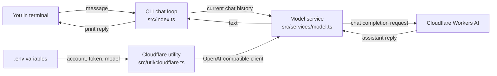
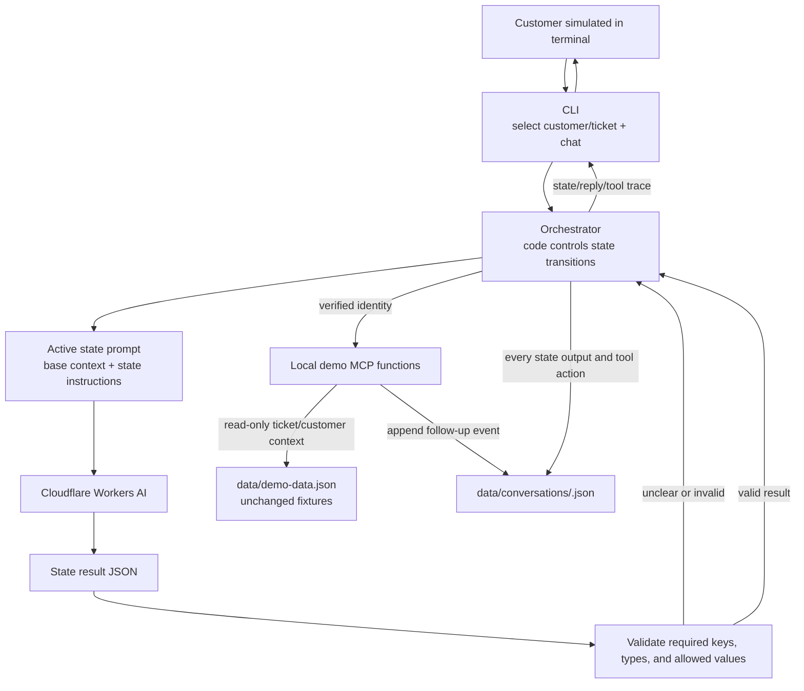
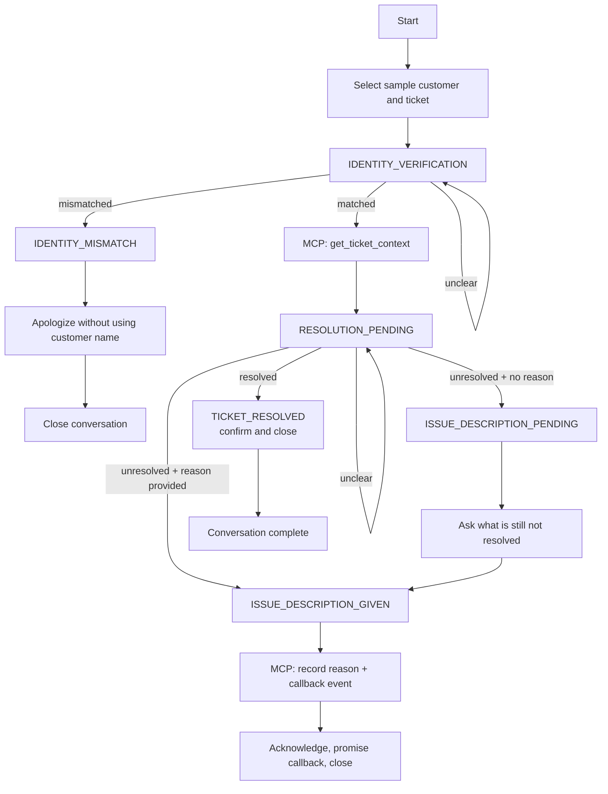

# Call Audit Prompt Chaining Demo

A terminal chatbot demo for learning how to build a deterministic, state-based support conversation with prompt chaining, structured JSON results, and local MCP tools.

The scenario is a follow-up from **NComputing India** after a technical support ticket has been closed. The chatbot verifies the customer, asks whether the issue is resolved, and records an unresolved reason and callback request in a local conversation log.

> **Current status:** Phase 1 is implemented: a basic terminal chat loop connected to Cloudflare Workers AI. The call-audit state prompts, orchestrator, sample customer selector, and demo MCP are planned for Phases 2 and 3 and are not implemented yet.

## Table of contents

- [What is prompt chaining?](#what-is-prompt-chaining)
- [What this demo is teaching](#what-this-demo-is-teaching)
- [Functional features](#functional-features)
- [How the system works](#how-the-system-works)
- [System components](#system-components)
- [Conversation state flow](#conversation-state-flow)
- [Run locally](#run-locally)
- [Run with DDEV](#run-with-ddev)
- [Environment variables](#environment-variables)
- [Project structure](#project-structure)
- [References](#references)
- [Current limitations](#current-limitations)

## What is prompt chaining?

Prompt chaining breaks a larger task into a sequence of smaller model steps. Each step has a focused prompt, receives the context it needs, and returns a result that the application can validate and pass to the next step.

For this project, the intended chain is a fixed customer-support workflow: verify identity, check ticket resolution, and, when needed, collect the unresolved reason. The application code acts as the orchestrator: it chooses which state prompt runs next and validates the model's JSON outcome before changing state. The model writes the response for the current step; code controls the workflow.

This is a **workflow using an LLM**, rather than an autonomous agent that chooses its own sequence of actions. Keeping the transitions in code makes the conversation easier to inspect and reason about. The current Phase 1 chatbot is a basic model-connected chat loop; the prompt chain is introduced in the later phases.

## What this demo is teaching

- How focused prompts can each handle one part of a larger conversation.
- How an orchestrator can keep the application in a state until it receives a valid state result.
- How to ask a model for structured JSON and validate it before using the result.
- How a tool/MCP boundary can fetch ticket context or record a follow-up.
- How local event logs can make the state transitions and tool actions inspectable.
- How to separate model-written language from deterministic application decisions.

## Functional features

### Implemented in Phase 1

- Start a chatbot in the terminal and send messages to Cloudflare Workers AI.
- Keep the current conversation's user and assistant messages in memory and send that history with each request.
- Configure the Cloudflare account, API token, and model through environment variables.
- Report all missing required configuration variables before opening the chat.
- Display model/API errors and exit the current chat; enter `/exit` or press Ctrl+C to end the session.

### Planned for Phase 2

- Add a shared base prompt with the agent personality, company context, and reason for contacting the customer.
- Add a separate prompt for each conversation state.
- Define strict JSON result contracts for each state and validate them before any transition.

### Planned for Phase 3

- Select a sample customer and ticket in the terminal with arrow-key navigation before a conversation starts.
- Verify identity, then fetch ticket and customer details through a local demo MCP function.
- Ask whether the ticket is resolved; when unresolved, collect a reason if the customer has not already provided one.
- Record an unresolved reason and callback request in a local per-conversation JSON event log.
- Keep `data/demo-data.json` read-only; do not mutate the sample customer or ticket fixtures.
- Show state transitions, MCP calls, and results in the terminal.

## How the system works

### Phase 1: current chatbot

The current code uses a normal chat-completions request. The chat history is kept in process memory for the duration of the terminal session. The Cloudflare utility builds the OpenAI-compatible endpoint URL from the account ID; the model service sends the messages and returns the assistant text.



### Planned call-audit system

The complete demo adds a deterministic orchestrator and per-state prompts. The model classifies/responds for the active step using a strict result shape. The orchestrator validates that result, decides whether to stay in the state or advance, and calls the local MCP functions when the locked workflow requires ticket data or a local follow-up record.



## System components

| Component | Responsibility | Status |
|---|---|---|
| Terminal CLI (`src/index.ts`) | Reads a message, sends the session history for a reply, and prints the response. Later it will also select sample customer/ticket and show workflow events. | Basic chat implemented; selection/events planned. |
| Cloudflare utility (`src/util/cloudflare.ts`) | Creates the OpenAI-compatible client using the account-specific Workers AI endpoint. | Implemented. |
| Environment loader (`src/util/env.ts`) | Loads `.env` and validates account ID, API token, and model. | Implemented. |
| Model service (`src/services/model.ts`) | Sends chat history to the selected model and returns non-empty assistant text. | Implemented. |
| Base and state prompts (`src/prompts/`) | Supply shared company context and the instructions for the current workflow state. | Planned for Phase 2. |
| Result contracts (`src/contracts/`) | Define and validate strict JSON outcomes for each state. | Planned for Phase 2. |
| Orchestrator (`src/orchestrator.ts`) | Runs state transitions in code; stays in the current state for unclear/invalid results. | Planned for Phase 3. |
| Demo MCP (`src/mcp/`) | Exposes named functions to list sample customers/tickets, fetch ticket context, and record unresolved follow-up. | Planned for Phase 3. |
| Fixture data (`data/demo-data.json`) | Holds synthetic sample customers and ticket details and remains read-only. | Planned for Phase 3. |
| Conversation event log (`data/conversations/`) | Stores state outputs and MCP actions in a separate JSON file for each conversation. | Planned for Phase 3. |

## Conversation state flow

This is the intended end-to-end workflow. A customer's identity mismatch closes the conversation without fetching ticket details. A verified customer proceeds to ticket context and the resolution question. If the issue is unresolved and a reason has not yet been given, the bot asks: **“What is still not resolved in this ticket?”**



The model does **not** control state transitions by itself. It returns a state-specific JSON result; the orchestrator validates it and applies the transition rules. For example, “hello” at identity verification does not count as a verified or mismatched identity, so the workflow remains at identity verification.

## Run locally

### Requirements

- Node.js 22 or newer
- pnpm 12.5.1 (the pinned version in `package.json`)
- A Cloudflare account with Workers AI access, an account ID, an API token with the required Workers AI permissions, and a model enabled for that account

### Install and configure

```sh
git clone https://github.com/aryanc381/prompt-chaining.git
cd prompt-chaining
pnpm install
cp .env.example .env
```

Edit `.env` and set all three Cloudflare values described below. Keep `.env` private; it is ignored by Git.

### Start chatting

```sh
pnpm dev
```

Type a message and press Enter. Enter `/exit` or press Ctrl+C to finish. The session history is kept only in memory and is discarded when the process exits.

To compile and run the JavaScript build instead:

```sh
pnpm build
pnpm start
```

## Run with DDEV

DDEV runs Node.js and pnpm inside its project container. This app is a terminal program, so you use `ddev exec` to run it; no browser URL or database is needed. The setup command below creates a generic project configuration, selects Node.js 22, and enables Corepack for pnpm.

### Requirements

- DDEV 1.24.3 or newer
- A working Docker provider configured for DDEV (Docker Desktop, OrbStack, Colima, or another supported provider)
- Cloudflare Workers AI account values

### Start the DDEV environment

From the repository directory, configure DDEV once:

```sh
ddev config --project-type=generic --webserver-type=generic --nodejs-version=22 --corepack-enable
ddev start
```

Create the local environment file:

```sh
cp .env.example .env
```

Fill in the Cloudflare values in `.env`, then install dependencies in the container:

```sh
ddev start
ddev exec pnpm --version
ddev exec pnpm install
```

If Corepack reports that pnpm is unavailable, restart DDEV so the `corepack_enable` setting is applied, then retry:

```sh
ddev restart
ddev exec pnpm --version
```

Run the interactive CLI from the repo root:

```sh
ddev exec pnpm dev
```

The terminal remains interactive. Type messages, press Enter, and use `/exit` to quit. To stop the DDEV project when finished:

```sh
ddev stop
```

The project directory is mounted into the container, so `.env` is read from the same project root and `node_modules`/build output are visible in the checkout. The application does not expose a web port or require a database.

## Environment variables

Copy the committed template before editing:

```sh
cp .env.example .env
```

| Variable | Required | Description |
|---|---|---|
| `CLOUDFLARE_ACCOUNT_ID` | Yes | Cloudflare account ID used in the Workers AI API URL. |
| `CLOUDFLARE_API_TOKEN` | Yes | Cloudflare API token permitted to invoke Workers AI for the account. Store it only in your local `.env`. |
| `CLOUDFLARE_AI_MODEL` | Yes | Workers AI model identifier enabled for your account. |

The wrapper calls the OpenAI-compatible Cloudflare endpoint:

```text
https://api.cloudflare.com/client/v4/accounts/<account-id>/ai/v1
```

If a value is empty or missing, startup prints the missing variable names and exits. If a model/API request fails, the CLI prints the error and ends the current chat. This demo does not retry failed requests.

## Project structure

```text
prompt-chaining/
├── .env.example                    # Cloudflare variable names; no secrets
├── data/                           # Planned: read-only fixtures and conversation logs
├── plans/
│   └── call-audit-prompt-chaining.md
├── src/
│   ├── index.ts                    # Terminal chat loop
│   ├── services/
│   │   └── model.ts                # Workers AI chat completion
│   └── util/
│       ├── cloudflare.ts           # Cloudflare endpoint/client wrapper
│       └── env.ts                  # Load and validate environment
└── package.json
```

As Phases 2 and 3 are implemented, `prompts/`, `contracts/`, `orchestrator.ts`, `cli/`, and `mcp/` will be added.

## References

This demo uses a deliberately small, code-orchestrated workflow. The references below informed the learning goals; they are not dependencies and do not imply that this demo uses Anthropic or OpenAI models.

- Anthropic, [Building effective agents](https://www.anthropic.com/engineering/building-effective-agents) — explains the distinction between predefined workflows and autonomous agents, and recommends starting with simple, composable patterns.
- OpenAI, [A practical guide to building agents](https://cdn.openai.com/business-guides-and-resources/a-practical-guide-to-building-agents.pdf) — discusses prompt templates, orchestration patterns, and when separating work into specialized agents may help.
- OpenAI, [Building agents](https://developers.openai.com/tracks/building-agents) — covers orchestration, tool calling, and structured outputs for application workflows.
- DDEV, [Node.js project quickstart](https://docs.ddev.com/en/stable/users/quickstart/) and [configuration options](https://docs.ddev.com/en/stable/users/configuration/config/) — describes generic Node project setup, Node version selection, and Corepack/pnpm configuration.

## Current limitations

- Phase 1 is a general chat loop, not yet the call-audit prompt chain.
- There is no state-specific prompt, JSON schema validation, customer/ticket selector, orchestrator, or MCP server yet.
- Phase 1 history exists only in memory; local conversation event logs are planned for Phase 3.
- The demo is not voice-enabled and does not make production ticket changes or contact real customers.
- Unclear replies remain in the current state once state orchestration is implemented; bounded retries and automated handoff are out of scope.
