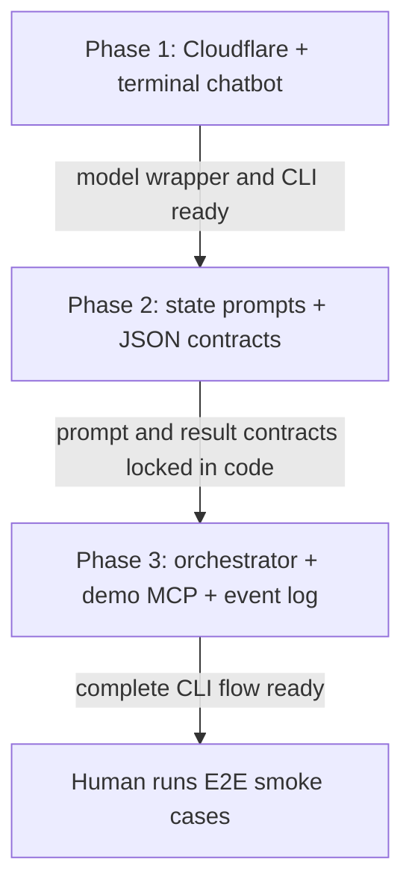

# Call Audit Prompt Chaining Demo — Implementation Plan

## 1. Goal and ownership

Build a local, terminal-based chatbot demo for NComputing India that demonstrates state-based prompt chaining and strict JSON outputs during a post-ticket-resolution customer follow-up.

| Repository | Ownership |
|---|---|
| `prompt-chaining` | Owns the complete demo: CLI, prompts, orchestration, local demo MCP, fixtures, conversation logs, Cloudflare Workers AI wrapper, and docs. |
| `circuit` | Read-only reference for the existing Cloudflare Workers AI setup pattern. No changes. |
| `circuit-ui` / `oms-ui` | Not involved. |

## 2. Functional features and exclusions

- Before a conversation, select a sample customer and ticket from an arrow-key CLI menu.
- Run identity verification, resolution confirmation, and unresolved-reason collection through state-specific prompts.
- Require each state to return its defined JSON shape; only valid, expected results allow a state transition.
- Fetch customer/ticket context and record unresolved follow-up through named local MCP tools.
- Keep `data/demo-data.json` read-only. Persist each conversation's state outputs and MCP actions in a separate local JSON event log.
- Display conversation, state transitions, MCP calls, and tool results in the terminal.
- Use Cloudflare Workers AI through a small wrapper in `src/util/cloudflare.ts`.
- Keep model requests stateless: send only the current customer utterance and the active state's explicitly supplied prompt/context; do not retain or resend prior turns as model chat history.

Explicitly excluded: changes to Circuit or other repos; real Circuit credentials or customer data; database persistence; mutating demo fixtures; voice telephony; bounded retries, automated handoff, or retry policies for unclear replies/tool failures. Unclear replies remain in the current state. Model/MCP failures are shown in the CLI and stop that conversation.

## 3. Data and ownership

No database model, collection, schema migration, or external persistence is introduced (`N/A`: this is a local CLI demo). The fixture is read-only and the log is append-only for each conversation.

```text
data/demo-data.json                         #REUSED — read-only sample source
  customers[]                                #READ
    id, name, organisation, phone_number, city
  tickets[]                                  #READ
    id, customer_id, ticket_number
    technical_information
      product, windows_version, vspace_version
      type_of_issue, solution, assigned_to

data/conversations/<conversation-id>.json  #NEW at runtime — workflow event log, not a transcript
  conversation_id, customer_id, ticket_id, started_at
  last_customer_message?                  # optional; replace on each turn, never keep older messages
  events[]                                 # append-only structured state/tool events
    event: timestamp, state, kind, state_result, tool, result
```

Operations: fixture customers and tickets `#READ`; fixture `#WRITE/#MODIFY/#DELETE` none. Conversation events are `#WRITE` by appending validated JSON state results and MCP-action results; no updates to the fixture. Do not persist a transcript or append every raw customer/assistant utterance. If the optional `last_customer_message` field is used, overwrite it with the newest customer message so it contains at most one utterance. The `record_unresolved_follow_up` tool records a callback-request event in the conversation log and returns the recorded result; it does not alter the ticket fixture. No indexes, compatibility migration, or schema rollout apply.

## 4. File tree

All application files below are new in `prompt-chaining`. The conversation log directory and its JSON files are created at runtime.

```text
prompt-chaining/
├── README.md                                #NEW — install, configure, run, and explain demo
├── .env.example                             #NEW — document Cloudflare settings without secrets
├── package.json                             #NEW — CLI scripts and minimal dependencies
├── tsconfig.json                            #NEW — TypeScript configuration
├── plans/
│   └── call-audit-prompt-chaining.md        #NEW — this approved implementation plan
├── data/
│   ├── demo-data.json                       #NEW — immutable sample customers and tickets
│   └── conversations/                      #NEW at runtime — per-conversation JSON event logs
└── src/
    ├── index.ts                             #NEW — CLI entry point
    ├── orchestrator.ts                      #NEW — deterministic state routing and transitions
    ├── cli/
    │   ├── select-customer.ts               #NEW — arrow-key customer/ticket selection
    │   └── conversation.ts                   #NEW — terminal conversation display/input
    ├── prompts/
    │   ├── base.ts                          #NEW — shared agent/company/purpose context
    │   └── states/
    │       ├── identity-verification.ts      #NEW — identity check prompt
    │       ├── identity-mismatch.ts          #NEW — apology and close response
    │       ├── resolution-pending.ts         #NEW — resolution question and ticket Q&A
    │       ├── ticket-resolved.ts            #NEW — resolved confirmation/close
    │       ├── issue-description-given.ts     #NEW — acknowledge reason and callback
    │       └── issue-description-pending.ts   #NEW — ask what remains unresolved
    ├── contracts/
    │   └── state-results.ts                 #NEW — strict per-state JSON schemas/types
    ├── services/
    │   └── model.ts                          #NEW — invoke model and parse state result
    ├── util/
    │   ├── cloudflare.ts                     #NEW — Workers AI OpenAI-compatible client wrapper
    │   └── env.ts                            #NEW — validate required Cloudflare environment
    └── mcp/
        ├── client.ts                         #NEW — invoke local demo MCP tools
        ├── server.ts                         #NEW — expose local MCP server
        └── ticket-tools.ts                   #NEW — implement customer/ticket read and log-write tools
```

## 5. Routes and tool contracts

HTTP routes: `N/A`; this is a local CLI and MCP demo, not an HTTP service. No removed routes or external API compatibility changes.

MCP functions use JSON inputs/outputs. Exact envelope shape follows the selected MCP SDK during implementation; the keys below define tool-level arguments and results.

| Function | Input | Success result | Failure behavior |
|---|---|---|---|
| `list_demo_customers` | `{}` | `{customers: [{id, name, organisation, city}]}` | MCP error surfaced in CLI; stop conversation if selection cannot load. |
| `list_customer_tickets` | `{customer_id}` | `{tickets: [{id, ticket_number}]}` | Unknown customer/tool error surfaced in CLI. |
| `get_ticket_context` | `{ticket_id}` | `{customer: {id, name, organisation, phone_number, city}, ticket: {id, ticket_number, technical_information: {product, windows_version, vspace_version, type_of_issue, solution, assigned_to}}}` | Unknown ticket/tool error surfaced in CLI; stop conversation. Called only after identity is verified. |
| `record_unresolved_follow_up` | `{conversation_id, ticket_id, reason_description}` | `{recorded: true, callback_requested: true, event_id}` | Invalid input or log-write error surfaced in CLI; stop conversation. Writes only to this conversation's local event log. |

These are local demo MCP tools, not authenticated Circuit APIs. No HTTP status codes, auth roles, or server routes apply. Tool inputs are validated for required identifiers and non-empty unresolved reason; outputs are validated before the orchestrator transitions. Repeated calls are not retried automatically. Event IDs make recorded actions visible in the log; tool-level deduplication is not required for this single-run demo.

## 6. Services and validation

| Owner | Function | Arguments | Return | Side effects | Callers |
|---|---|---|---|---|---|
| `services/model.ts` | `getStateResult` | client, model, state, state prompt, current message, explicit context | validated `StateResult` | Cloudflare model request | orchestrator (Phase 3) |
| `orchestrator.ts` | `handleStateResult` | current state, parsed result, context | next state or closed | appends state output event | CLI loop |
| `mcp/ticket-tools.ts` | `listDemoCustomers` | none | customer summaries | reads fixture | selector |
| `mcp/ticket-tools.ts` | `listCustomerTickets` | customer ID | ticket summaries | reads fixture | selector |
| `mcp/ticket-tools.ts` | `getTicketContext` | ticket ID | customer and ticket context | reads fixture | orchestrator after verified identity |
| `mcp/ticket-tools.ts` | `recordUnresolvedFollowUp` | conversation ID, ticket ID, reason | recorded/callback result | appends event to conversation JSON | orchestrator after valid reason |
| `util/cloudflare.ts` | `createCloudflareClient` | validated env config | model client | none | model service |
| `cli/conversation.ts` | `runConversation` | selected customer/ticket | completed/stopped | collects terminal input; displays events | entry point |

State result validation uses strict schemas with required keys, enums, and types. Identity outcomes distinguish `matched`, `mismatched`, and `unclear`; only matched proceeds to ticket-context lookup. Resolution outcomes distinguish resolved/unresolved and whether a reason was supplied. `reason_description` is required when the reason is supplied and must be non-empty. An unclear or malformed result leaves the state unchanged and prompts again in the current conversation loop; no bounded retry count or retry/handoff policy is added. A model or MCP error is printed and stops the active conversation. The log records successful state outputs and tool actions; a log-write failure is surfaced and stops the run.

Identity mismatch response: “Sorry to disturb you. Have a good day.” Do not include the customer name. Ticket context is fetched only after verified identity. Resolved tickets close without a ticket write. For unresolved issues, collect a reason if absent, then record the callback request in the conversation event log.

### State JSON contracts

The strict Zod contracts in `src/contracts/state-results.ts` are authoritative and reject extra keys, missing fields, invalid enums, invalid reason combinations, malformed JSON, and results whose `state` does not match the active prompt.

```json
{"state":"identity_verification","verification_status":"matched","reply":"Thanks for confirming."}
{"state":"identity_mismatch","outcome":"closed","reply":"Sorry to disturb you. Have a good day."}
{"state":"resolution_pending","ticket_resolution":"unresolved","reason_provided":true,"reason_description":"The device still disconnects.","reply":"I understand the issue is still happening."}
{"state":"ticket_resolved","outcome":"closed","reply":"Thank you for confirming. Have a good day."}
{"state":"issue_description_given","reason_description":"The device still disconnects.","callback_requested":true,"reply":"I’m sorry about the trouble. We’ll arrange a callback shortly."}
{"state":"issue_description_pending","reason_status":"unclear","reason_description":"","reply":"What is still not resolved in this ticket?"}
```

When no reason is supplied, `reason_provided` is `false` and `reason_description` is empty. Only an unresolved result can include a reason. For the reason-pending state, `reason_status` is `provided` exactly when `reason_description` is non-empty. Every result includes the customer-facing `reply` that the future CLI will display.

### Dependencies and Cloudflare pattern

Use a minimal TypeScript CLI, a terminal arrow-key selector, a JSON schema validator, the official MCP TypeScript SDK, and the OpenAI-compatible client if needed by the Cloudflare endpoint. Confirm package versions and APIs during implementation. Pattern `src/util/cloudflare.ts` after `circuit/apps/perceptron/src/services/assistant.service.ts` and `circuit/apps/perceptron/src/env.ts`: API token, account ID, model, and `https://api.cloudflare.com/client/v4/accounts/{account_id}/ai/v1` base URL. Read only those Circuit files/patterns; do not change Circuit. Keep credentials in local environment variables and `.env.example` contains placeholders only.

## 7. E2E smoke path (human-run)

The engineer runs these cases manually after implementation. Codex does not run or claim E2E results as part of this planning task.

| Case | Setup | Action | Expected API/data result | Expected CLI result |
|---|---|---|---|---|
| Phase 1 stateless chat | Configure valid Cloudflare env | Send a one-off unique code phrase, then in a separate turn ask what it was | Each model request contains exactly one user message; no message transcript is written; optional latest-message field contains at most the newest utterance | Second turn has no access to the phrase from the first turn; CLI remains open between requests |
| Resolved success | Configure valid Cloudflare env; use sample fixture | Select customer/ticket; verify identity; confirm resolved | Fixture unchanged; conversation JSON contains valid state outputs and context-fetch action; no follow-up write | Correct transitions; resolved close message; event/tool trace shown |
| Unresolved with reason | Same | Verify identity; say unresolved and give reason | Fixture unchanged; conversation log includes `record_unresolved_follow_up` with reason and callback requested | Acknowledgement, callback statement, close; MCP result shown |
| Unresolved without reason | Same | Verify identity; say unresolved without reason; answer “What is still not resolved in this ticket?” | Fixture unchanged; reason and callback event appended to conversation log | Remains in reason-pending state until valid reason; then records and closes |
| Identity mismatch | Same | Say identity does not match | No ticket-context fetch; fixture unchanged; mismatch state output logged | Apology without customer name, then close |
| Unclear reply | Same | Give an unclassifiable reply at identity or resolution state | No invalid transition or ticket write; unclear result logged | Remains in same state and asks again |
| Invalid JSON/model failure | Use invalid model output or unavailable Cloudflare configuration | Start a conversation | No invalid state transition; no fixture change; only already completed events remain in log | Clear error shown; active conversation stops on service failure |
| MCP failure | Use unavailable local MCP server or invalid ticket ID | Trigger the affected tool call | No fixture mutation; no fabricated successful event | Tool error shown; active conversation stops |

## 8. Symbols flow diagram

```text
[CLI starts] -> [Arrow-key customer/ticket selection] -> [Identity prompt]
                                                            |
                             +------------------------------+----------------+
                             |                                               |
                       [mismatch]                                      [matched]
                             |                                               |
             [apologize, no name, close]                    [MCP: fetch ticket context]
                                                                             |
                                                                             v
                                                              [Ask if ticket is resolved]
                                                               /                 \
                                                       [resolved]              [unresolved]
                                                           |                       |
                                                  [confirm and close]      [reason present?]
                                                                               /       \
                                                                             yes       no
                                                                              |         |
                                                                              |   [ask what is
                                                                              |    still unresolved]
                                                                              +----+----+
                                                                                   |
                                                   [MCP: append follow-up + callback event]
                                                                                   |
                                                                                 [close]

          [state outputs and MCP actions] -> [local per-conversation JSON event log]
          [unclear reply] -> [stay in current state]
          [model/MCP failure] -> [show error and stop conversation]
```

## 9. Delivery phases and agent orchestration

### Phase 1 — Cloudflare connection and terminal chatbot

- **Outcome:** A runnable terminal chatbot sends each user message independently to Cloudflare Workers AI and prints the response.
- **Prerequisites:** Node/pnpm (or selected package manager), valid Cloudflare account ID, API token, and model setting.
- **Verification:** Human runs the CLI with configured environment and confirms a model request/reply; missing configuration produces a clear startup error.

### Phase 2 — State prompts and strict JSON contracts

- **Outcome:** Shared base context, prompts for each state, and strict schemas for structured outcomes.
- **Prerequisites:** Phase 1 model wrapper and CLI call loop.
- **Verification:** TypeScript build succeeds. Human exercises each state prompt in the future CLI after Phase 3 wiring; malformed and unclear outcomes must not advance state.

### Phase 3 — Orchestrator, subprompts, and demo MCP end-to-end

- **Outcome:** Customer/ticket arrow selector, deterministic state machine, local MCP functions, immutable fixtures, and per-conversation JSON event logs work together in the full demo.
- **Prerequisites:** Phase 2 prompts/contracts; sample fixture and MCP tool definitions.
- **Verification:** Human runs the success, unresolved, mismatch, unclear, and service-failure cases in the smoke table and inspects that fixture data is unchanged and events are logged.

### Agent orchestration

Single-agent sequential implementation. Parallel subagents are not useful because Phase 2 depends on Phase 1 interfaces and Phase 3 depends on the prompt contracts and state outcomes from Phase 2. Phase 1 and Phase 2 implementation are complete; Phase 3 remains.



## 10. Assumptions, risks, compatibility, and locked decisions

- The demo runs locally and uses synthetic sample customer/ticket data. It is not connected to Circuit or production systems.
- Cloudflare Workers AI credentials/model are supplied by the engineer at runtime; no secrets are committed.
- Conversation logs may contain the sample customer context and model results. Keep fixtures synthetic; logs are local and one file is written per conversation.
- Model output can be malformed or unclear. Strict validation prevents state advancement; unclear outcomes remain in the current state, while model/MCP service failures stop the conversation. Retries/handoff are explicitly out of scope.
- The chosen Cloudflare endpoint/client and MCP SDK versions must be confirmed during implementation.
- The fixture remains unchanged; unresolved follow-up/callback is represented only as an event in the conversation log.
- All implementation belongs to the new `prompt-chaining` repo; `circuit` is only a read-only pattern reference.

## 11. Validation performed for this plan

- Reviewed Circuit's plan skill and its staged artifact requirements.
- Reviewed the Circuit Perceptron Cloudflare client/environment pattern to inform the wrapper design.
- Confirmed the new `prompt-chaining` directory exists and is empty before planning artifact creation.
- Phase 2 added the shared and six state prompts, strict Zod result contracts, and a stateless model-service entry point. The CLI is not wired to them until Phase 3.
- `pnpm run build` and `git diff --check` pass after Phase 2. No tests or E2E smoke run was performed; the CLI E2E smoke remains human-run after Phase 3.
